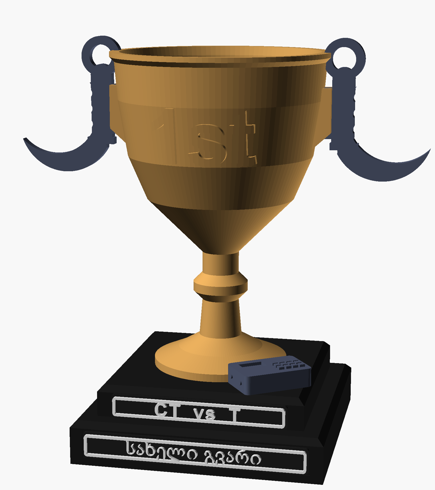
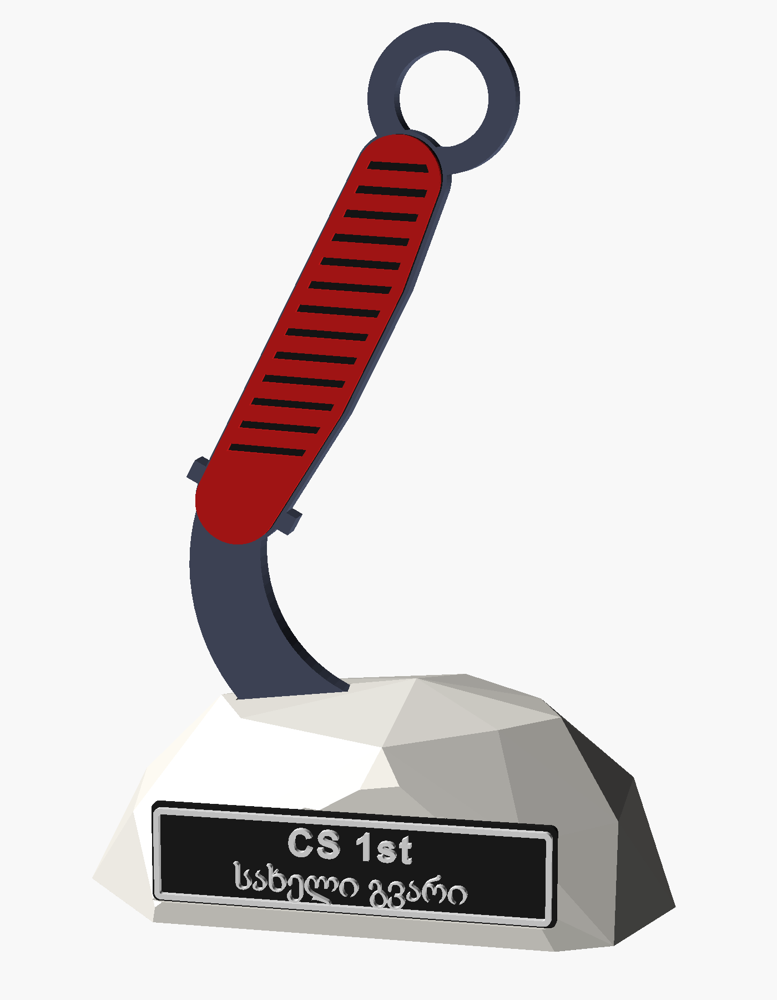
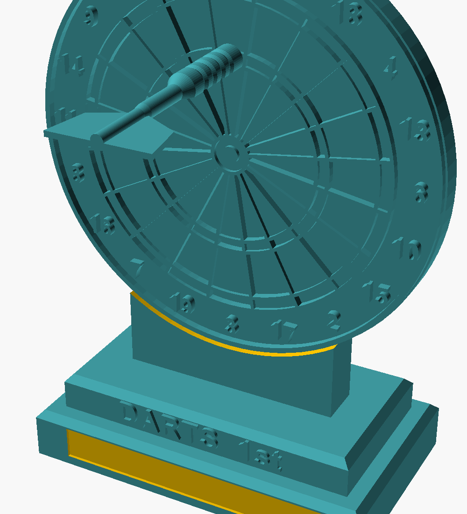
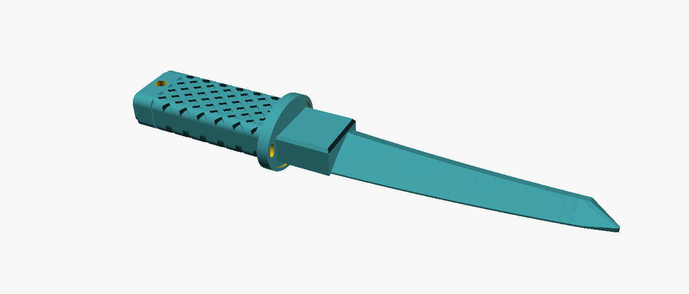

# 3D-printable tournament trophies

Parametric trophies for gaming and darts tournaments, designed in OpenSCAD and printed on an FDM printer (FlashForge Adventurer 4 Pro, Anycubic Vyper). Every part prints **without supports**; colour is done with filament swaps at set layers, so a single-nozzle printer is enough.

Put the winner's name in the `winner` variable (Georgian and Latin fonts are both set up), render, export STL, slice.

| | |
|---|---|
|  |  |
| **CS cup** — classic cup with karambit handles, C4 brick and two name plates | **Karambit in stone** — knife set in a low-poly rock, name plate on the front |
|  |  |
| **Darts** — dartboard on a stepped base, dart plugs into treble 20 | **Katana USB case** — handle + blade-shaped cap for a USB stick |

## Models

| Folder | Source | Ready STL | Notes |
|---|---|---|---|
| [`csgo-cup/`](csgo-cup) | `CSGO_trophy.scad` | — | parts: `cup`, `knife` ×2, `base`, `c4`, `plates`, `assembled` |
| [`karambit/`](karambit) | `Karambit_trophy.scad` | — | parts: `knife`, `scales`, `rock`, `plate`, `assembled` |
| [`darts/`](darts) | `Darts_trophy_v2.scad`, `Darts_plates.scad` | board, base, dart halves | board colour changes by height: black → red segments → white wires |
| [`katana-usb/`](katana-usb) | `Katana_usb.scad` | full plate | measure your USB stick and adjust `pcb_*` first |

## How to use
1. Open the `.scad` file in [OpenSCAD](https://openscad.org).
2. Set `part = "..."` to the piece you want and, for name plates, `winner = "..."`.
3. Render (F6) and export STL (F7).
4. Slice. For two-colour plates and the darts board, add a **pause / filament change** at the layer noted in the file's header comment.

Fonts used: Arial Bold for Latin text, Sylfaen for Georgian. Swap `font_lat` / `font_geo` if you don't have them.

## Print notes (darts trophy, as printed)
- Matte PLA at 215 °C nozzle / 55 °C bed; Silk PLA dart halves at 218 °C. No supports; brim on the dart halves.
- Board: black → red → white, two filament-change pauses. Plates: 1 mm black backing, pause at layer 6, 1 mm white text.
- The dart is printed as two halves and glued, with 1.75 mm filament pieces as alignment pins.

## License
[CC BY 4.0](LICENSE) — free to print, remix and sell prints, just credit **MirianTs**.

CS-themed models are fan-made and not affiliated with Valve.
